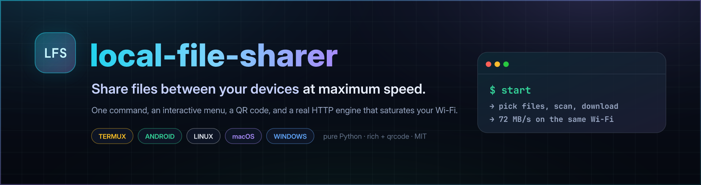
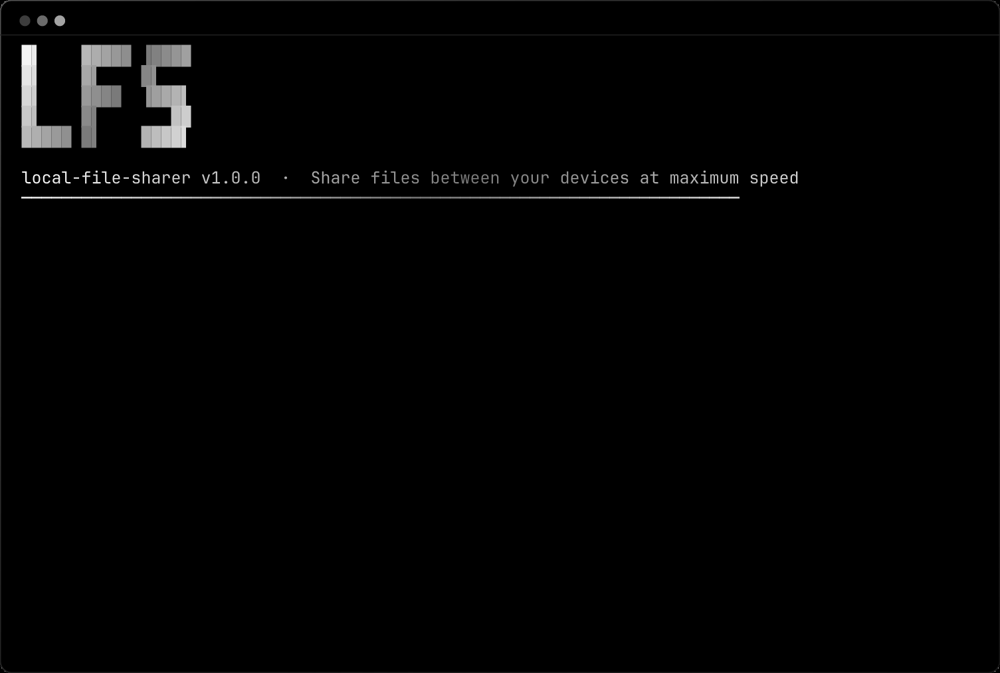
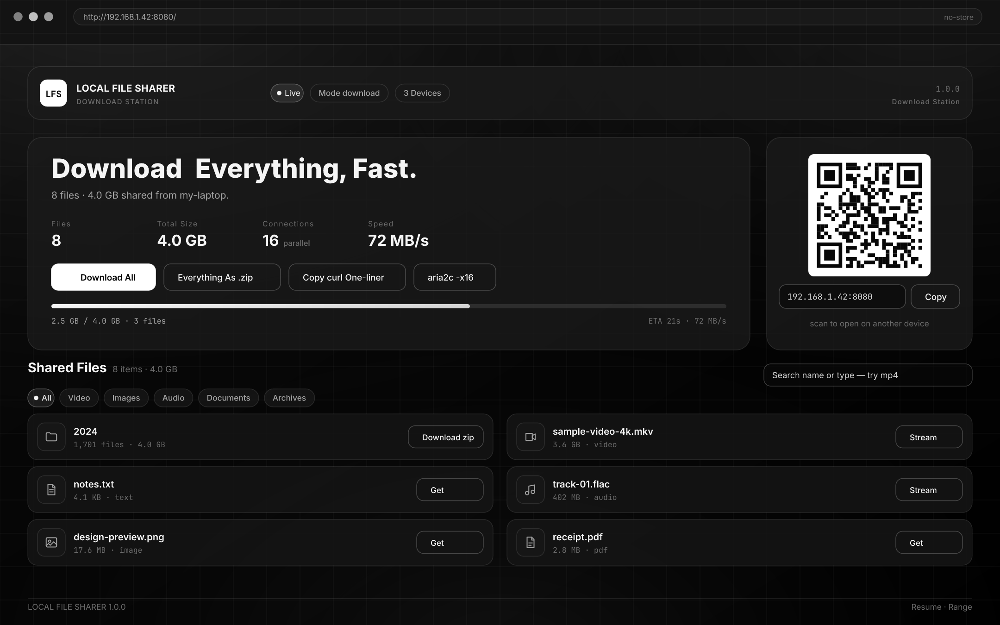
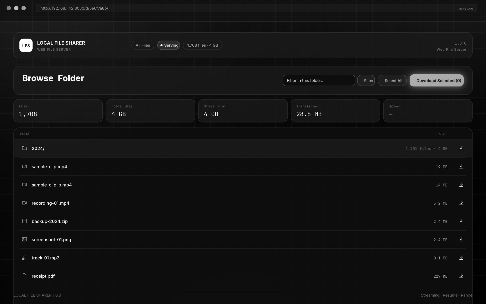
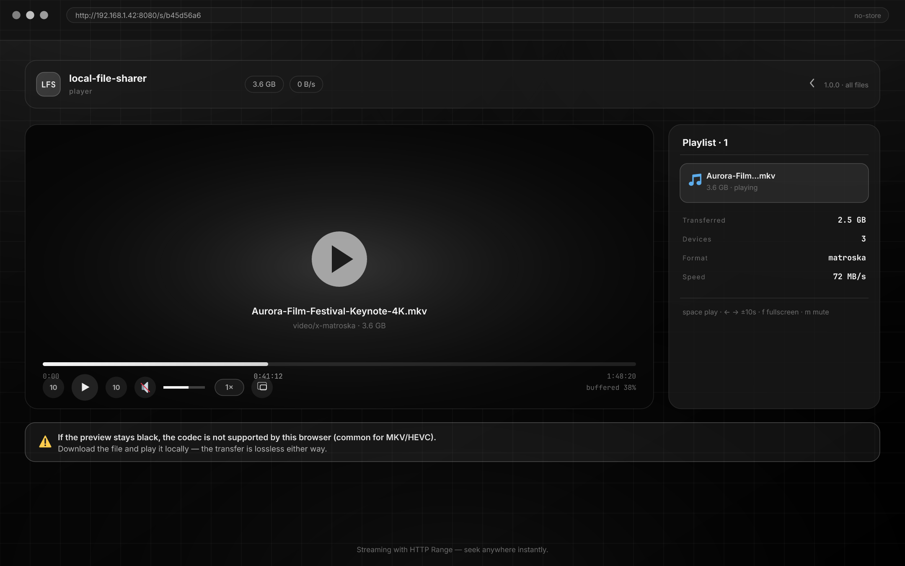
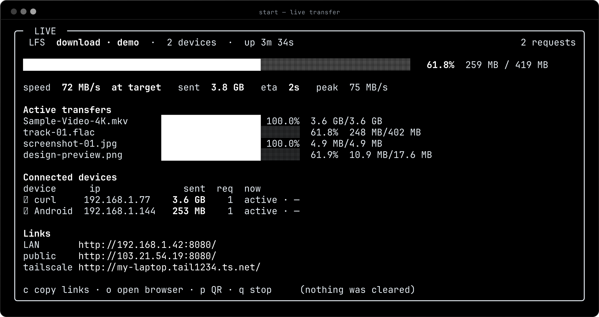
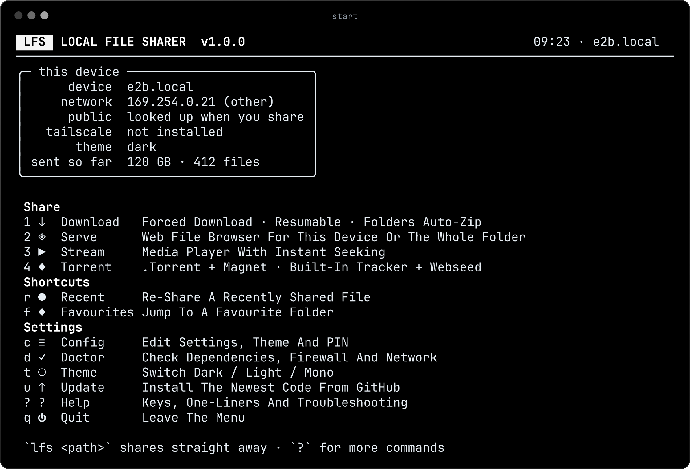
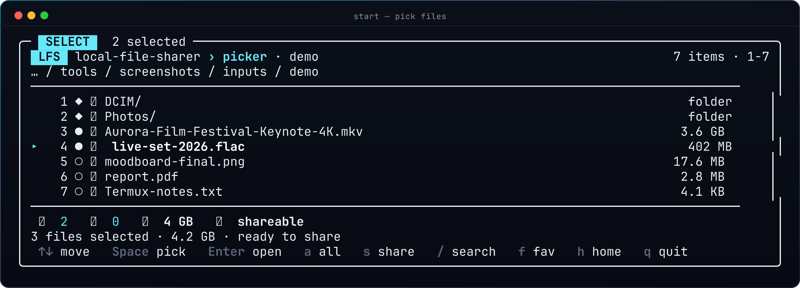
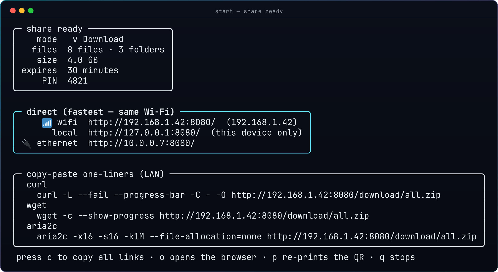

<div align="center">



# local-file-sharer

**Share files between your devices at maximum speed — straight from your terminal.**

One command (`lfs`), an interactive menu, a QR code, and a real HTTP engine that
saturates your Wi-Fi. Works on **Termux/Android**, **Linux**, **macOS** and **Windows**.

[](https://www.python.org/)
[](#platform-support)
[](LICENSE)
[](../../actions/workflows/ci.yml)
[](../../releases/latest)
[](https://github.com/astral-sh/ruff)
[](#why-it-is-fast)



</div>

---

## Table of contents

- [Why it is fast](#why-it-is-fast)
- [Demo](#demo)
- [Features](#features)
- [Install](#install)
  - [If you just want it running](#if-you-just-want-it-running)
  - [The three commands](#the-three-commands)
  - [One file (no git, no URL to type)](#one-file-no-git-no-url-to-type)
  - [Termux (Android)](#termux-android)
  - [When `lfs` is not the copy you just upgraded](#when-lfs-is-not-the-copy-you-just-upgraded)
  - [Linux / macOS](#linux--macos)
  - [Windows](#windows)
  - [From source](#from-source)
- [Quick start](#quick-start)
- [The file picker](#the-file-picker)
- [Share modes](#share-modes)
- [Network outputs](#network-outputs)
- [One-liners for every device](#one-liners-for-every-device)
- [Configuration](#configuration)
- [Command reference](#command-reference)
- [Diagnostics](#diagnostics)
- [Shell integration & completions](#shell-integration--completions)
- [Performance notes](#performance-notes)
- [Troubleshooting](#troubleshooting)
- [Roadmap](#roadmap)
- [Project layout](#project-layout)
- [Development](#development)
- [Security](#security)
- [License](#license)

---

## Why it is fast

| Technique | Where | Effect |
|---|---|---|
| `os.sendfile` zero-copy | Linux · Termux · macOS | Kernel moves file → socket, no user-space copy |
| `socket.sendfile` fallback | Windows | Native `TransmitFile` path instead of a Python loop |
| 4 MiB socket buffers + `TCP_NODELAY` | every platform | Fewer round trips, higher throughput on Wi-Fi |
| HTTP `Range` + `multipart/byteranges` | server | `aria2c -x16`, resumable `curl -C -`, seekable video |
| 16-connection parallel download button | web UI | Splits files into byte ranges and stitches them |
| Streaming ZIP64 (no temp files) | server | A 40 GB folder starts downloading instantly |
| No caching, no compression in the hot path | server | No CPU spent on gzip while transfer is the bottleneck |

### Measured throughput

Both rows are real transfers of a 200 MB random file through the actual server
(`tests/` reproduces the range maths; the numbers below come from a loopback run
on a 2-vCPU container, so they measure the engine, not the network):

| Test | Result |
|---|---|
| 1 × sequential `GET /f/<id>` | **210 MB in 0.22 s → 946 MB/s** |
| 16 × parallel `Range` requests | **210 MB in 0.26 s → 809 MB/s**, SHA-256 identical to sequential |
| Streaming ZIP + `Range` resume | resumed bytes byte-identical at a 1/3 cut |
| Wire format | every response carries `Accept-Ranges: bytes`, `Content-Length` and a stable `ETag` |

On real Wi-Fi the link is the limit, not the code: the engine keeps a 4 MiB
in-flight window per connection and `lfs doctor` reports whether the zero-copy
path is active on your machine.

---

## Demo

<div align="center">

| Download station | Web file server | Media player |
|---|---|---|
|  |  |  |

</div>

The CLI: a gradient banner that shimmers once, a picker that never clears your
scrollback, and a live dashboard with speed, ETA, progress, devices and total sent.

<div align="center"></div>

---

## Features

| Area | What you get |
|---|---|
| **Picker** | scroll-friendly, never clears the screen, auto-fits any width, inline icons, no *Type* column, Windows drive letters, fuzzy search (`/`), `6,7,8` / `6-8` selection, folder summaries (files, subfolders, size, shareable) |
| **Modes** | **Download** (forced, resumable, folders auto-zipped) · **Serve** (web file browser) · **Stream** (player with seeking) · **Torrent** (`.torrent` + magnet, built-in tracker, HTTP webseed) |
| **Networks** | LAN/Wi-Fi IP first (QR + one-liners), public IP, Tailscale auto-detect (`serve`/`funnel`), Cloudflare Tunnel with a slow-speed warning |
| **Speed** | `os.sendfile` → `socket.sendfile` fallback, 4 MiB buffers, `Range` support, 16-connection parallel downloader |
| **Web UIs** | download station, file browser, media player — all offline-capable, browser caching disabled |
| **CLI polish** | animated banner, three monochrome themes (**dark / light / mono**), live transfer dashboard that redraws in place |
| **Convenience** | fuzzy picker, recent files, favourite folders, one-key clipboard copy of links and one-liners |
| **Safety** | optional PIN/password, auto-expiring links, upload toggle, gitignored per-machine secrets |
| **Settings** | `~/.config/local-file-sharer/config.toml` (`%APPDATA%` on Windows) with env overrides |
| **Maintenance** | `lfs doctor`, `lfs upgrade`, friendly errors with fixes instead of tracebacks |
| **Shells** | completions for **fish**, **bash**, **PowerShell** and **zsh**; `lfs` function for fish incl. Windows |

---

## Install

> Requirements: **Python 3.9+**. Everything else is optional (`aria2c`,
> `tailscale`, `cloudflared` unlock extra features).

### If you just want it running

One command, no git, nothing to type from memory:

```bash
python3 -c "import urllib.request;urllib.request.urlretrieve('https://github.com/Erawat4l/local-file-sharer/raw/main/install-lfs.py','install-lfs.py')" && python3 install-lfs.py
```

It unpacks a complete copy to `~/local-file-sharer`, builds it, and leaves you
with the `lfs` command. Then, once:

```bash
lfs configure     # port, PIN, theme, starting folder (Enter accepts each default)
lfs               # the menu
```

### The three commands

Prefer a checkout you can `git pull`? Clone it, go in, install it.

```bash
git clone https://github.com/Erawat4l/local-file-sharer.git
cd local-file-sharer
./run install
```

Both routes end the same way: one command, `lfs`, that works from any
directory. `./run install` links it into a directory that is **already on your
PATH** (`~/.local/bin` or `~/bin`, whichever your shell searches), so there is
no PATH editing afterwards.

If neither directory is on your PATH, the installer says so and prints the
line for your shell — it does not leave you with a successful install and a
`command not found`:

```text
! ~/bin is not on PATH, so `lfs` will not be found yet
  add it for good:
    fish:  fish_add_path ~/bin
    bash:  echo 'export PATH="$HOME/bin:$PATH"' >> ~/.bashrc
  or just run ./run from this folder
```

`./run install` builds a private `.venv` in the checkout, downloads `rich` and
`qrcode`, and links `lfs` onto your PATH — a progress bar runs while it
downloads, so it never looks frozen. When it finishes you have one command,
`lfs`, and it works from any directory:

```bash
lfs configure    # once: port, PIN, theme, starting folder (Enter accepts each default)
lfs              # the menu, any time after
```

Everything you do afterwards is `lfs`: `lfs doctor`, `lfs upgrade`, `lfs ~/Downloads`.
`./run` still exists inside the checkout and runs exactly the same binary, but it
is only there for the checkout itself — the command to remember is `lfs`.

**Updating is one command**, and it is not `./run`:

```bash
lfs upgrade
```

In a clone this runs `git pull` in the checkout and reinstalls what it pulled,
behind a progress bar, and prints what changed. Anywhere else — a `pipx`
install, a frozen build, a copy unpacked from `install-lfs.py` — it reinstalls
from GitHub instead. Either way it is the same command, and the same one the
menu's **Update** item runs.

**First run on Termux** needs Python and pip before any of this (once only):

```bash
pkg install python python-pip
```

`run` finds Python but will not install it for you. Termux keeps pip in its own
package — `python` has the `venv` module but no pip and no `ensurepip`, so a
virtualenv made without `python-pip` cannot install anything. With it present,
`run` builds the venv with `--system-site-packages` so it can borrow that pip
and install into itself.

Termux also has no `/tmp` — `run` keeps its error output in `.lfs-tmp` inside
the checkout — and if pip is missing anyway, `run` offers to install
`python-pip` for you (skip that with `LFS_NO_AUTOINSTALL=1`).

One more Termux trap, because it is common and looks nothing like its cause: if
the interpreter's own C extensions are mismatched, every install fails from deep
inside pip with `dlopen failed: cannot locate symbol "XML_GetCurrentLineNumber64"`.
That is `libexpat` being older than the `python` package that links against it,
and `run` now says so instead of letting pip print 64 lines about build
toolchains. The fix is:

```bash
pkg update && pkg upgrade
pkg install --reinstall libexpat python
```

### When `lfs` is not the copy you just upgraded

This is the most confusing failure the app has, and it is not rare: a device can
end up with several `lfs` binaries, and the oldest one is usually first on
`PATH`, so it answers every command. The symptoms look unrelated — an old menu,
a subcommand that "does not exist", `lfs configure` doing something else
entirely — because a *different program* is running.

Ask which copy is which:

```bash
lfs doctor            # the INSTALL section names the winner
```

It looks like this when something is shadowing you:

```
INSTALL
▲   copy wins  /data/data/com.termux/files/home/bin/lfs  (pip, runs first)
•   copy       /data/data/com.termux/files/usr/bin/lfs   (pip, shadowed)
    fix: rm /data/data/com.termux/files/home/bin/lfs
```

Remove the one that wins, in one command:

```bash
lfs doctor --fix-copies
```

It removes only copies that shadow this one, and leaves a `pipx` install alone
(printing `pipx uninstall local-file-sharer` instead, since deleting a pipx
launcher by hand leaves a broken half-install). Some shells then need telling
to forget the old path — **the command differs per shell**, and the wrong one
just prints an error:

| Shell | Command |
|---|---|
| fish | nothing — fish reads `$PATH` on every command |
| bash / zsh | `hash -r` |
| sh | `command -v lfs` |
| PowerShell | `$env:PATH = $env:PATH` |

Two wrong answers have been printed here before, both for fish. `hash -r` is
bash/zsh only (`fish: Unknown command: hash`), and `rehash` was a fish function
that has since been removed (`fish: Unknown command: rehash`). In fish the
correct answer is that no command is needed.

`lfs doctor --fix-copies` prints the right line for the shell you ran it from.

`lfs` also prints a one-line warning at startup when it detects this, so you are
not left guessing. Silence it with `LFS_NO_COPY_WARNING=1`.

**If `lfs upgrade` seems stuck** on `0/5 contacting GitHub`, it is not stuck: the
bar now shows elapsed seconds, and an update that hears nothing from the network
for four minutes is abandoned with an explanation instead of hanging. A weak
connection is the usual reason; retrying, or using `install-lfs.py` on a slow
link, is the fix.

**Upgrading a copy installed from an old branch** used to reinstall that branch
forever. If a copy was installed once from something like
`arena/d7f4713b-local-file-sharer`, `lfs upgrade` now recognises it as a finished
branch and follows `main` instead, saying so on the way past.

### One file (no git, no URL to type)

Prefer not to clone? Download `install-lfs.py` and run it:

```bash
python3 install-lfs.py
```

It unpacks a complete checkout to `~/local-file-sharer` and prints the two
commands that matter. The virtualenv is built on first launch, so:

```bash
cd ~/local-file-sharer && ./run            # build, then start
cd ~/local-file-sharer && ./run upgrade    # update
```

Useful when a terminal font makes `Erawat4l` hard to type — its last character
is a lowercase **L**, not a digit — or when you would rather not clone.

### Termux (Android)

```bash
pkg update && pkg install python python-pip git
pipx install "local-file-sharer @ git+https://github.com/Erawat4l/local-file-sharer.git"
termux-setup-storage   # once, so the picker can read /sdcard
lfs                    # ← the command is `lfs`, not `start`
```

`python-pip` is not optional here: Termux's `python` package provides the
`venv` module but neither pip nor `ensurepip`, so `pipx` has nothing to work
with. `pipx` itself comes from `pkg install pipx` if it is missing.

If `lfs` is not found immediately, open a new session (the installer adds
`~/.local/bin` to PATH). `start` is **not** installed — it collides with other
Android tooling, which is why the command was renamed.

The installer also offers `aria2`, `zip`, `curl` and `wget`, and writes the fish
function + completions when fish is present.

### Linux / macOS

```bash
pipx install "local-file-sharer @ git+https://github.com/Erawat4l/local-file-sharer.git"
```

Prefer doing it by hand? It is **not on PyPI yet**, so point pip at the repo:

```bash
pipx install "local-file-sharer @ git+https://github.com/Erawat4l/local-file-sharer.git"
# or
python3 -m pip install --user "local-file-sharer @ git+https://github.com/Erawat4l/local-file-sharer.git"
```

On Debian/Ubuntu the system Python is "externally managed" (PEP 668); a
`--user` install needs `--break-system-packages`, which the installer adds
automatically. `pipx` avoids the question entirely and is recommended.

Flags: `--dev` (editable install from a checkout), `--no-extras`, `--no-fish`,
`--yes`, `--uninstall`.

### Installing from source

`git+https://…` installs work without a GitHub account. If a network blocks
`raw.githubusercontent.com`, read the installer through the API instead — it
serves the same bytes:

```bash
gh api "repos/Erawat4l/local-file-sharer/contents/install-lfs.py" \
       -H "Accept: application/vnd.github.raw" > install-lfs.py
python3 install-lfs.py
```

(`install.sh` is the other installer — pip/pipx rather than a self-contained
file. It is reachable the same way, replacing `install-lfs.py` in that command.)

Setting the repository to public makes the plain `curl` form work, and then
this file is all a new person needs.

### Windows

```powershell
pipx install "local-file-sharer @ git+https://github.com/Erawat4l/local-file-sharer.git"
```

The PowerShell installer:

1. finds Python 3.9+ (or tells you exactly how to install it),
2. installs with `pipx` (preferred) or `pip --user`,
3. wires the **fish** function at `%APPDATA%\fish\functions\lfs.fish` (if fish
   is installed),
4. puts **`lfs.cmd`** on your PATH, so `lfs` works in `cmd.exe` and PowerShell —
   unlike `start`, `lfs` is not a shell built-in, so it can be a real command,
5. registers PowerShell tab completion.

```text
any shell:   lfs
fish:        lfs                  # plus the function, so it behaves the same
manual:      local-file-sharer    # the underlying entry point
```

If PowerShell blocks the script, use:
```powershell
Set-ExecutionPolicy -Scope Process -ExecutionPolicy Bypass
```

There is also a **standalone `local-file-sharer.exe`** attached to every tagged
release — no Python required. `lfs upgrade` replaces it with the newest build when running the
frozen build.

### From source

```bash
git clone https://github.com/Erawat4l/local-file-sharer.git
cd local-file-sharer
python3 -m venv .venv && . .venv/bin/activate
pip install -e ".[dev]"
lfs --help
```


---

## What a new person needs

One command, no git, no GitHub account, no token:

```bash
python3 -c "import urllib.request;urllib.request.urlretrieve('https://github.com/Erawat4l/local-file-sharer/raw/main/install-lfs.py','install-lfs.py')" && python3 install-lfs.py
```

That is the whole install. It unpacks to `~/local-file-sharer`, builds a
virtualenv, links `lfs` onto a directory already on your PATH, and tells you
where it went. Afterwards:

```bash
lfs configure     # once
lfs               # any time
```

**Requirements:** Python 3.9+ and a network connection for the first run (it
downloads `rich` and `qrcode` from PyPI). Nothing else. `aria2c`, `tailscale`
and `cloudflared` are optional and unlock extra features.

Verified end to end as an anonymous user — no credentials, clean `HOME`, no
`PATH` help — because that is the only test that proves an install works for
someone who is not you.

`install-lfs.py` is also self-contained: it carries the entire source, so if
`raw.githubusercontent.com` is blocked or you would rather hand someone a file,
copy it over (USB, chat, a local share) and run `python3 install-lfs.py`. It
then needs no GitHub access at all — only PyPI.

Prefer a real checkout, so `git pull` and `lfs upgrade` work natively? Use the
[three commands](#the-three-commands) instead.

## Updating

```bash
lfs upgrade
```

The package is not on PyPI and has no release tags yet, so `lfs --update`
(which compares against a GitHub *release*) can only report `404`. `lfs upgrade`
installs the current code from the branch this copy came from:

```bash
lfs upgrade                              # same branch you installed from
lfs upgrade --ref main                   # a specific branch or tag
```

It uses `pipx install --force` for pipx installs, `pip install --upgrade` for
plain ones (retrying with `--break-system-packages` on Debian/Ubuntu), and
refuses to touch a standalone `.exe` — download that from Releases instead.

## Quick start

```bash
lfs                            # interactive menu
lfs ~/Movies                   # share a folder in download mode
lfs film.mkv episode.mp4       # share several files
lfs --mode stream ~/Videos   # pick media, open the player
lfs --mode torrent ~/Photos  # .torrent + magnet + tracker + webseed
lfs doctor                   # check tools, firewall, network
lfs config show              # effective configuration
lfs upgrade                  # install the newest code from GitHub
```

<div align="center"></div>

---

## The file picker



```text
▸   5  ○ 📄 clip.mp4                                  12.0 MB
    6  ○ 🖼️ one.jpg                                    4.9 KB
    7  ○ 🖼️ two.png                                    3.0 KB
    8  ● 📁 photos/                                   folder
```

| Key | Action |
|---|---|
| `↑ ↓` / `j k` | move |
| `PgUp` `PgDn` | page |
| `Enter` | open folder / add file |
| `b` / `Backspace` | up one folder |
| `6,7,8` or `6-8` | select by number, then `Enter` |
| `a` / `c` | select all / clear |
| `s` | share the selection |
| `/` | fuzzy search this folder |
| `f` | favourite / unfavourite folder |
| `d` `h` | drives · home |
| `?` `q` | help · quit |

The footer always shows the live summary — **files · subfolders · size · shareable
status** — and folders are analysed as you select them.

---

## Share modes

| Mode | Command | What the other device gets |
|---|---|---|
| **Download** | `lfs --mode download <paths>` | One landing page with every file, a "download all" button using 16 parallel range requests, and a resumable `.zip` for folders |
| **Serve** | `lfs --mode serve <folder>` | A web file browser (search, multi-select, breadcrumbs, download folder as zip) |
| **Stream** | `lfs --mode stream <media>` | A media player page with seeking, playback speed, playlist and keyboard control |
| **Torrent** | `lfs --mode torrent <paths>` | A real `.torrent` + `magnet:` link, a **built-in HTTP tracker** and an **HTTP webseed** so pieces come straight from this machine |

All modes support the PIN gate, expiry and (optionally) uploads back to you.

With `--upload`, the browser gets a drop zone: anything dropped there is written
**into the folder you shared**, under its plain filename (path separators are
stripped, and an existing name is suffixed rather than overwritten). The listing
you can see was built when the share started, so refresh it — or look in the
folder — to see what arrived. `lfs doctor` reports whether uploads are on.

Each of those four paths runs against a real server on a real socket in
`tests/test_e2e.py` — the login `POST` and its cookie, `/api/manifest`, a
byte-identical download, `206` on `Range`, the player page, the tracker's
bencoded `announce` reply and the webseed's ranged reads. What is *not* proven
is a swarm: the webseed serves pieces over HTTP, but no second BitTorrent client
has been run against the tracker yet (see the roadmap).

<div align="center">

</div>

---

## Network outputs

`lfs` publishes, in order of usefulness:

1. **Direct LAN/Wi-Fi** — the primary link, the QR code and every one-liner.
   Detected without third-party packages: Wi-Fi interfaces win over Ethernet,
   virtual bridges are ignored.
2. **Public IP** — looked up in a background thread so it never blocks the menu.
3. **Tailscale** — auto-detected. If you are logged in you are asked once:
   publish with `tailscale serve`, or `--funnel` for the public internet, or skip.
4. **Cloudflare Tunnel** — you are asked whether to generate a quick tunnel,
   with an explicit **slow-speed warning** (1–8 MB/s, relayed through the edge).

```bash
lfs --tailscale            # yes to Tailscale, no question asked
lfs --no-tailscale --cloudflare
lfs --funnel --expire 30   # public via tailscale funnel, expires in 30 min
```

---

## One-liners for every device

`lfs` prints and copies these automatically (clipboard support: `pbcopy`,
`wl-copy`, `xclip`, `xsel`, `termux-clipboard-set`, `clip.exe`):

```bash
curl -L --fail --progress-bar -C - -O http://192.168.1.42:8080/download/all.zip
wget -c --show-progress http://192.168.1.42:8080/download/all.zip
aria2c -x16 -s16 -k1M --file-allocation=none http://192.168.1.42:8080/download/all.zip
```

```powershell
Invoke-WebRequest -Uri "http://192.168.1.42:8080/download/all.zip" -OutFile all.zip -UseBasicParsing
Start-BitsTransfer -Source "http://192.168.1.42:8080/download/all.zip" -Destination $env:USERPROFILE\Downloads\all.zip
```

While a share is running: `c` copies all links, `o` opens the browser, `p`
re-prints the QR, `q` stops the share.

---

## Configuration

`lfs config init` writes `~/.config/local-file-sharer/config.toml`
(`%APPDATA%\local-file-sharer\config.toml` on Windows):

```toml
theme = "dark"                  # dark | light | mono
accent = "cyan"                 # any colour name or #RRGGBB
animate_banner = true
icons = true

[network]
port = 8080
host = "0.0.0.0"
prefer_interface = ""           # e.g. "wlan0"
public_ip_lookup = true

[speed]
socket_buffer = 4194304
parallel_connections = 16
use_sendfile = true
zip_compression = 1

[share]
pin = ""
auto_expire_minutes = 0
allow_upload = false
show_qr = true
copy_links = true
one_liners = ["curl", "wget", "aria2c", "powershell"]

[tools]
tailscale = "auto"              # auto | require | off
cloudflared = "auto"

[ui]
page_size = 14
live_dashboard = true
recent_limit = 12
```

Layered, in increasing priority:

1. built-in defaults → 2. `config.toml` → 3. `./config.local.toml`
(gitignored, for **secrets** such as device 2's SSH host, static IPs or tokens)
→ 4. `LOCAL_FILE_SHARER_*` environment variables
(`LOCAL_FILE_SHARER_NETWORK__PORT=9000`) → 5. CLI flags.

```bash
lfs config show | init | path | reset
lfs config get network.port
lfs config set network.port 9000
lfs config set share.pin 1234
```

> **Never commit secrets.** `config.local.toml`, `.env*`, keys and runtime state
> are all in [`.gitignore`](.gitignore). See [SECURITY.md](SECURITY.md).

---

## Command reference

```text
lfs [paths ...] [options]            share now (no paths → interactive menu)

  -m, --mode {download,serve,stream,torrent}
  -p, --port PORT            --pin [PIN]        --expire MINUTES
  --upload                   --open             --no-qr        --no-copy
  --tailscale | --no-tailscale                --funnel
  --cloudflare | --no-cloudflare
  --theme {dark,light,mono}  --no-anim          --icons | --no-icons
  --interface IFACE          --no-dashboard     --json        --debug

lfs menu                       open the menu explicitly
lfs doctor [--json] [--fast]   diagnostics
lfs config  show|init|path|get|set|reset
lfs theme   dark|light|mono|next|list [--preview]
lfs completions fish|bash|powershell|zsh
lfs banner  [--loop]           preview the animated banner
lfs version | help
lfs upgrade [--ref BRANCH]   # update from GitHub (no PyPI, no releases needed)
lfs --check-update           # compare against a GitHub release, if one exists
```

---

## Diagnostics

```text
$ lfs doctor
 LFS  doctor                                     local-file-sharer 1.0.0 · Ubuntu 24.04

    RUNTIME
✔   python        3.11.9 (CPython/Linux)
✔   os             Ubuntu 24.04 · my-laptop
✔   terminal       xterm-256color · 120 cols · colour
✔   clipboard      wl-copy

    PERFORMANCE
✔   sendfile       os.sendfile available (zero-copy)
✔   socket buffer  4.0 MB send buffer

    NETWORK
✔   LAN address    192.168.1.42 (wifi), 100.101.102.103 (other)
✔   bind port      0.0.0.0:8080 is free

 health 100%  ·  0 blocking issue(s), 0 warning(s)
```

`lfs doctor` checks Python and dependencies, optional tools (`tailscale`,
`cloudflared`, `aria2c`, `zip`, `curl`, `wget`, `ffmpeg`), the zero-copy path,
socket buffers, disk space, LAN addresses, the public IP, the bind port,
firewall commands for your OS, Tailscale/Cloudflare readiness, your config
files and the clipboard. `--json` gives machine-readable output for CI.

---

## Shell integration & completions

```bash
lfs completions fish        > ~/.config/fish/completions/lfs.fish
lfs completions bash        > ~/.local/share/bash-completion/completions/lfs
lfs completions powershell  # dot-source from $PROFILE (install.ps1 does it)
lfs completions zsh         > ~/.zfunc/_lfs
```

`install.sh` also drops [`shell/fish/lfs.fish`](shell/fish/lfs.fish) into
`~/.config/fish/functions/`, so typing `lfs` always means *local-file-sharer*
in fish, with `share` and `lfs` as aliases.

On Windows, `lfs` stays a built-in in `cmd.exe` and PowerShell — that is why
[`shell/windows/share.cmd`](shell/windows/share.cmd) exists as the fallback and
why the fish function is installed separately.

---

## Performance notes

- **Zero-copy sends.** On Linux/Android/macOS the socket path is `os.sendfile`;
  on Windows `socket.sendfile` is used. Both bypass the Python byte loop.
- **Big buffers.** 4 MiB `SO_SNDBUF`/`SO_RCVBUF`, `TCP_NODELAY`, and
  `TCP_WINDOW_CLAMP` on Linux. Tunable in `[speed]`.
- **Parallel ranges.** The web UI's download button issues 16 `Range` requests
  per file and stitches them into a Blob; CLI users get `aria2c -x16`.
- **Streaming ZIP.** Folders are zipped on the fly with ZIP64; ran offsets are
  deterministic, so a resumed download produces a byte-identical archive
  (verified in the test suite for 7 different cut points).
- **Store-first ZIP.** Media is stored (no deflate) since it is already
  compressed; small text files are deflated in memory up to 64 MiB so the byte
  layout stays resumable.
- **No caching.** Every page/API response carries
  `Cache-Control: no-store, no-cache, must-revalidate` so phones never show a
  stale file list.

---

## Troubleshooting

<details>
<summary><b>The other device cannot connect</b></summary>

1. Are both devices on the **same Wi-Fi**? (Guest networks and AP isolation block it.)
2. Run `lfs doctor` and check the *bind port* row.
3. Open the port in your firewall:

```bash
# Linux (ufw)                     # Windows (elevated)
sudo ufw allow 8080/tcp           netsh advfirewall firewall add rule name="lfs" ^
                                    dir=in action=allow protocol=TCP localport=8080
```

Termux: keep the notification visible and disable battery optimisation for Termux.
</details>

<details>
<summary><b>Permission denied when opening a folder (Termux)</b></summary>

```bash
termux-setup-storage    # grants read access to /sdcard
```
</details>

<details>
<summary><b>Slow speed over Cloudflare</b></summary>

Expected — quick tunnels are relayed through Cloudflare's edge (1–8 MB/s).
Use direct Wi-Fi for LAN transfers, or Tailscale for a VPN link instead.
</details>

<details>
<summary><b>`lfs` opens a new window on Windows</b></summary>

`lfs` is a `cmd.exe`/PowerShell built-in. In fish, the installed function
takes precedence. In cmd/PowerShell use `share` (installed by `install.ps1`), or
call `local-file-sharer` directly.
</details>

<details>
<summary><b>Video stays black in the player</b></summary>

The browser cannot decode that codec (MKV/HEVC are common). The transfer is
lossless — download the file and play it locally. `ffmpeg` converts on the host.
</details>

<details>
<summary><b>Port already in use</b></summary>

`lfs --port 9000`, or `lfs config set network.port 9000`. `lfs` will
auto-increment from the configured port when it is busy.
</details>

<details>
<summary><b>Anything else</b></summary>

Run it again with `--debug` for a traceback, or
[open an issue](../../issues/new/choose) with the `lfs doctor --json` output.
</details>

---

## Roadmap

- [x] download / serve / stream / torrent modes
- [x] zero-copy transfers, Range, 16-connection downloads
- [x] PIN, expiry, uploads, themes, dashboard, doctor, completions
- [x] standalone Windows `.exe` in releases
- [ ] **WebRTC** data channels for NAT-to-NAT transfers without a tunnel
- [ ] **Resumable uploads** from the browser UI (chunked, restartable)
- [ ] **Native Android share sheet** integration for Termux
- [ ] **QR pairing codes** that prefill PIN + expiry
- [ ] **Multi-file torrent** seeding from a real peer (not only the webseed)
- [ ] **Plugin API** for custom landing pages

Vote with a 👍 on an issue, or open a PR — see [CONTRIBUTING.md](CONTRIBUTING.md).

---

## Project layout

```text
local-file-sharer/
├── src/local_file_sharer/
│   ├── cli.py               argparse + dispatch (the `lfs` command)
│   ├── menu.py              interactive main menu
│   ├── picker.py            file picker model (listing, fuzzy, selection)
│   ├── share.py             orchestrator: pick → prepare → publish → wait
│   ├── config.py            layered TOML config + env overrides
│   ├── state.py             recents, favourites, totals, history
│   ├── platforms.py         OS matrix: sendfile, drives, tools, clipboard
│   ├── network.py           LAN/public IP, Tailscale, Cloudflare, firewall
│   ├── doctor.py            diagnostics
│   ├── updater.py           `lfs upgrade` from GitHub, `--update` for releases
│   ├── completions.py       fish/bash/PowerShell/zsh scripts
│   ├── qr.py                terminal + SVG + PNG QR rendering
│   ├── transfer/
│   │   ├── manifest.py      share model and URL layout
│   │   ├── http_handler.py  Range/ETag/zip/torrent routes
│   │   ├── server.py        threaded server lifecycle
│   │   ├── zipstream.py     resumable streaming ZIP64
│   │   ├── torrent.py       bencode, .torrent, tracker, webseed
│   │   └── stats.py         live transfer statistics
│   ├── ui/                  theme, banner, picker UI, dashboard
│   └── web/assets/          downloader / server / player HTML + CSS
├── shell/                   fish functions and the Windows share.cmd
├── tests/                   300+ pytest tests (loopback only, no internet)
├── install.sh · install.ps1
└── docs/assets/             README images
```

---

## Development

```bash
git clone https://github.com/Erawat4l/local-file-sharer.git
cd local-file-sharer
python3 -m venv .venv && . .venv/bin/activate
pip install -e ".[dev]"

ruff check src tests && ruff format --check src tests
pytest -q                      # ~350 tests, loopback sockets only
pytest --cov=local_file_sharer
```

Conventional Commits (`feat:`, `fix:`, `docs:`, `perf:`, `chore:` …) are enforced
by review; releases are cut from tags named `vX.Y.Z` and built for Windows and
Linux by GitHub Actions, with the standalone `.exe` attached to the release.

---

## Security

- Shares are **open by default on your LAN** — use `--pin` and `--expire` on
  untrusted networks.
- No telemetry, no accounts, no cloud dependency. The only outbound calls are the
  ones you enable (public-IP lookup, tunnels, update check).
- Secrets belong in `config.local.toml` (gitignored), never in `config.toml`.
- Report vulnerabilities privately: see [SECURITY.md](SECURITY.md).

---

## License

MIT © [Erawat4l](https://github.com/Erawat4l) — see [LICENSE](LICENSE).

<div align="center"><sub>Built with <a href="https://github.com/Textualize/rich">rich</a> and <a href="https://github.com/lincolnloop/python-qrcode">qrcode</a>. No telemetry, no accounts, no cloud.</sub></div>
